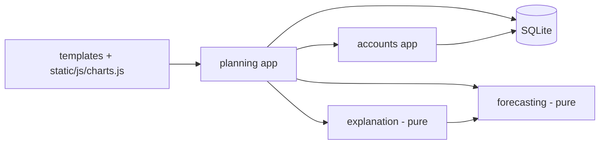
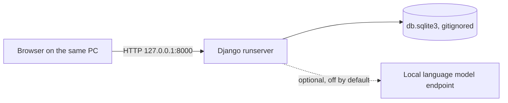
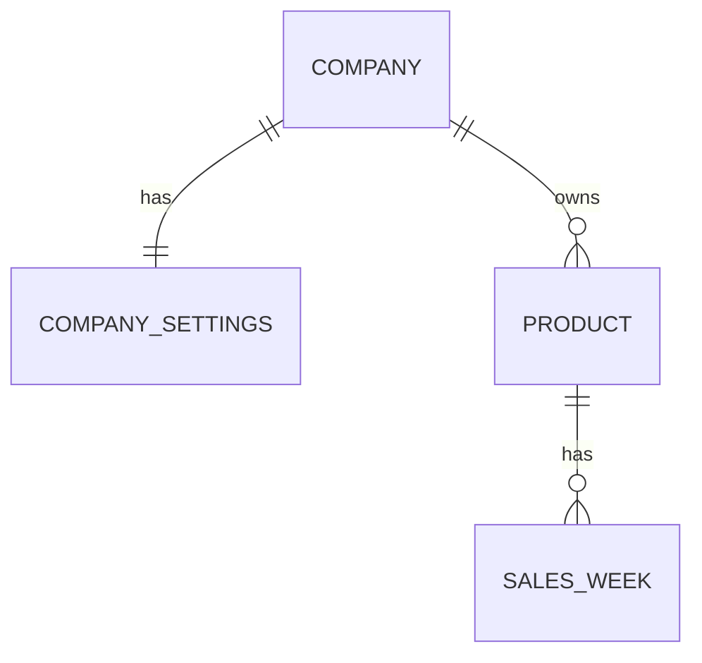

# Architecture Spine — Prognose

## Design Paradigm

A **server-rendered Django monolith with a functional core**. The core (`forecasting/`, `explanation/`) is pure Python: data in, results out, with no Django, database or network access. The shell (the Django apps `accounts/` and `planning/`, plus templates and static files) loads inputs, calls the core, renders HTML and handles every write.



Arrows point from the depender to the dependency. Nothing points back into the shell. The pure core and `planning/queries.py` are the seams for later growth, such as another UI, an API or hosting, without touching the rules.

## Invariants & Rules

### AD-1 — Functional core, imperative shell [ADOPTED]
- **Binds:** all; NFR-2
- **Prevents:** calculation rules leaking into views, models or templates, where they can't be unit-tested against the reference examples
- **Rule:** `forecasting/` and `explanation/` never import Django, the ORM or a network library. Django apps may import them; the reverse never happens.

### AD-2 — One compute entry point
- **Binds:** FR-5 to FR-19, FR-24, FR-33 to FR-36; R-1 to R-17
- **Prevents:** two screens showing different numbers for the same product
- **Rule:** `forecasting.compute_product(history, stock_on_hand, settings)` returns a frozen `ProductResult`, and `forecasting.sort_overview(results)` applies R-12. Views, templates, `charts.js`, the explanation and tests read values only from `ProductResult`. Nothing else recalculates or re-sorts.

### AD-3 — Results are computed, never stored
- **Binds:** FR-21, FR-22, NFR-8
- **Prevents:** stale cached results after a settings change, and two owners of one computed value
- **Rule:** the database holds inputs only: sales weeks, stock on hand, settings and adjustments. Every request computes the results it shows.

### AD-4 — One rounding and one display format
- **Binds:** R-9, FR-12, FR-35, NFR-5
- **Prevents:** a figure shown as 70 on one screen and 71 on another, or as «14.3» next to «14,3»
- **Rule:**
  - `forecasting/` keeps full precision. All R-9 rounding happens in `forecasting/rounding.py`: 6 decimals before rounding up, then display rounding half away from zero.
  - Norwegian display (decimal comma, U+2212 minus, a no-break space before %) comes from one pure module, `forecasting/display.py`. The template filters, the explanation and the chart data all call it.
  - `compute_product` returns numbers, never formatted strings.

### AD-5 — The company is the authenticated principal [ADOPTED]
- **Binds:** FR-1, NFR-3
- **Prevents:** two ways of linking data to a company, and pages reachable without login
- **Rule:** the custom user model `accounts.Company` has `customer_number` as its login field and is created before the first migration. Passwords use Django's default PBKDF2 hasher. `LoginRequiredMiddleware` denies by default, and only the landing/login view is exempt.

### AD-6 — Company isolation in one data-access module
- **Binds:** FR-2, SM-4
- **Prevents:** one view forgetting the company filter and leaking another company's data
- **Rule:** every read or write of company data goes through `planning/queries.py` functions that take the logged-in company first and filter by it. Views never use model managers for company data. A lookup outside the company raises `Http404`. The two-account test covers every view and list.

### AD-7 — Weeks by position, products by varenummer per company
- **Binds:** PRD §3 (Week), R-10 to R-15, FR-18
- **Prevents:** calendar arithmetic that disagrees with the reference examples, and URL clashes between companies
- **Rule:** a sales week is identified by (product, `position` 1..N), and `position` orders every calculation. Year and week number are used only for display and the seasonal index. `varenummer` is unique within a company only. Products are addressed as `/produkter/<varenummer>/` and resolved through `queries.py`.

### AD-8 — Server-side mutations with Post/Redirect/Get
- **Binds:** FR-20 to FR-22, FR-29, NFR-10, NFR-11
- **Prevents:** client-side state that diverges from the server, double submissions, and inconsistent validation
- **Rule:**
  - Login, logout, settings changes and adjustments are HTML form POSTs (CSRF on), followed by a redirect.
  - Filters are GET parameters.
  - There are no fetch calls and no client-side state.
  - Each company has one `CompanySettings` row, validated server-side with Norwegian messages; a decimal comma or point is accepted.
  - The defaults and allowed ranges (FR-20) are defined once, in `forecasting/settings.py`. The form validates against those constants.

### AD-9 — Adjusted quantities behind one service
- **Binds:** FR-29 to FR-31
- **Prevents:** two storage mechanisms for adjustments
- **Rule:** adjusted order quantities live in the Django session, keyed by varenummer and latest data week, and are reached only through `planning/adjustments.py`. FR-31 (Could) replaces the storage behind the same functions.

### AD-10 — Explanation boundary
- **Binds:** FR-26 to FR-28, AG-1 to AG-5, NFR-1
- **Prevents:** a number in the explanation that the calculation did not produce, and network calls from anywhere else
- **Rule:** `explanation.explain(result)` builds the template text from `ProductResult` only. The optional local model is reached only through `explanation/rephrase.py`, with a 10 s timeout and the number-and-label check, and any failure falls back to the template. No other module calls a model or the network.

### AD-11 — UI rendering
- **Binds:** NFR-1, NFR-6, NFR-7, NFR-11; the UX spines
- **Prevents:** a CDN dependency, chart logic duplicating calculations, and drift from the approved design
- **Rule:**
  - Pages are Django templates with one stylesheet that defines the DESIGN.md tokens as CSS custom properties.
  - Albert Sans is self-hosted and Chart.js is vendored.
  - The only JavaScript is `static/js/charts.js`. It draws from `json_script` data and computes nothing. Every number it prints arrives as a display string from the server.
  - DESIGN.md and EXPERIENCE.md win over the mockups.

### AD-12 — Seed data and secrets
- **Binds:** FR-1, FR-3, FR-4, NFR-3, DR-4
- **Prevents:** plaintext passwords in the repository, and a manual setup step for the secret
- **Rule:**
  - `data/generate_seed.py` deterministically writes the versioned seed files in `data/seed/`. They hold inputs and password hashes only.
  - `python manage.py load_seed` resets the database idempotently.
  - `load_seed` also creates the gitignored session-secret file when it is missing.

### AD-13 — Local run mode
- **Binds:** NFR-1, NFR-9, NFR-10, SM-2
- **Prevents:** debug pages or stack traces reaching the examiner
- **Rule:** the app runs as one local process (`python manage.py runserver --insecure`, 127.0.0.1). `runserver` is used only on the user's own PC; the app is never deployed or exposed to a network. DEBUG is off by default and serves Norwegian 404 and 500 pages; only `.env` can turn DEBUG on for development. `LANGUAGE_CODE = 'nb'` and `TIME_ZONE = 'Europe/Oslo'`.

### AD-14 — One test command and one answer key
- **Binds:** NFR-2, DR-3, SM-1, SM-3, SM-4
- **Prevents:** tests and the reference spreadsheet drifting apart
- **Rule:**
  - `python manage.py test` runs every test.
  - Forecasting tests read expected values only from `reference/examples.json`, which the spreadsheet mirrors.
  - The core-flow and isolation tests use the Django test client.
  - Ruff lints and formats.

## Consistency Conventions

| Concern | Convention |
| --- | --- |
| Naming | Code is in English with the PRD glossary terms (`base_forecast`, `week_forecasts`, `safety_margin`, `stock_on_hand`, `weeks_of_cover`, `order_soon`, `confidence_label`). UI text is Norwegian, using the glossary labels and fixed strings verbatim. URL slugs are Norwegian (`/produkter/`, `/bestilling/`, `/logg-ut/`). |
| Data & formats | `varenummer` is a string of digits. Quantities are integers. Forecasts are floats. Percentages are stored as whole numbers (10 means 10 %). Enum values: `moving_average` and `exponential_smoothing`; `included` and `excluded`. |
| Errors | User-facing messages are Norwegian and name the problem and the fix. Validation keeps the previous value (FR-20). Unknown addresses and other companies' objects give the same «ikke funnet» page. |
| Logging | Console logging only. Never log passwords, the session secret or full request bodies (NFR-4). |
| Config | Settings come from the environment, with an optional `.env` read by a small standard-library parser. `.env.example` lists `DEBUG`, `PROGNOSE_LLM_URL` and `PROGNOSE_LLM_MODEL`. Nothing in `.env` is needed for the basic setup. |
| Dependencies | Exact pins in one `requirements.txt`. No other Python packages without a new AD. |
| Delivery order | Must items first. Should and Could items start only after SM-1 and SM-3 pass (DR-6). |

## Stack

| Name | Version |
| --- | --- |
| Python | 3.13 |
| Django | 5.2.19 (LTS, supported to April 2028) |
| SQLite | bundled with Python (≥ 3.31) |
| Chart.js (vendored) | 4.6.1 |
| Albert Sans (self-hosted, OFL) | Google Fonts release at build time |
| Ruff | 0.17.4 |

## Structural Seed

```text
G40-lyamouri/
  manage.py, requirements.txt, .env.example, README.md, PRODUCT.md
  prognose/      # Django project: settings, urls, wsgi
  accounts/      # Company (custom user), login and logout
  planning/      # models, queries.py, adjustments.py, forms, views, templates, templatetags
  forecasting/   # pure: rules R-1 to R-17, rounding.py, compute_product, sort_overview
  explanation/   # pure: explain(), number check, optional rephrase.py
  static/        # css (tokens + app), fonts, vendor/chart.js, js/charts.js
  templates/     # base, landing, 404, 500
  data/          # generate_seed.py and seed/ (versioned)
  reference/     # examples.json and the reference spreadsheet
  docs/          # process documents, QA log, status table, AI steering log
```





## Capability → Architecture Map

| Capability / Area | Lives in | Governed by |
| --- | --- | --- |
| Login and isolation (FR-1, FR-2) | `accounts/`, `planning/queries.py` | AD-5, AD-6 |
| Seed data and storage (FR-3, FR-4) | `data/`, `planning` models, `load_seed` | AD-12 |
| Forecasts, scenarios, orders (FR-5 to FR-13) | `forecasting/` | AD-2, AD-3, AD-4, AD-7 |
| Warnings and confidence (FR-14 to FR-19, FR-36) | `forecasting/` | AD-2 |
| Settings (FR-20 to FR-23) | `planning` (CompanySettings, forms, views) | AD-8 |
| Overview, product screen, forecast calculation (FR-24, FR-25, FR-35) | `planning` views and templates, `static/js/charts.js` | AD-2, AD-11 |
| Explanation (FR-26 to FR-28) | `explanation/` | AD-10 |
| Purchase planning (FR-29 to FR-32) | `planning/adjustments.py`, views | AD-8, AD-9 |
| Accuracy and stock through weeks 2 and 3 (FR-33, FR-34) | `forecasting/` | AD-2 |
| Quality and delivery (NFR-1 to NFR-11, DR-1 to DR-9) | conventions, `docs/` | AD-11 to AD-14 |

## Deferred

- **Local model runtime and model (FR-28, PRD question 5):** chosen when FR-28 is scheduled. AD-10 already fixes the seam.
- **Exact schemas of the seed files and `reference/examples.json`:** set in the data story. AD-12 and AD-14 fix where they live and who reads them.
- **Could items (per-product settings FR-23, saved adjustments FR-31, CSV export FR-32):** decided when scheduled. FR-31 swaps the storage behind AD-9.
- **Caching:** only if the NFR-8 check fails, and it needs an amendment to AD-3.
- **How Impeccable reads the single DESIGN.md during the build:** decided in the first UI story. There is never a second copy.
- **Hosting beyond localhost:** out of scope (NFR-1, PRD §7).
