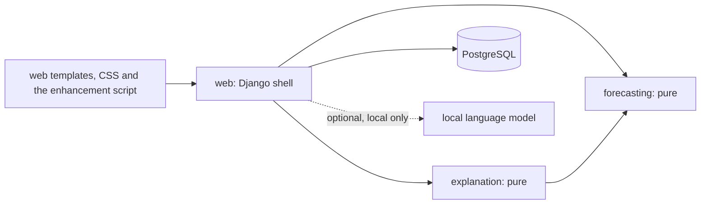
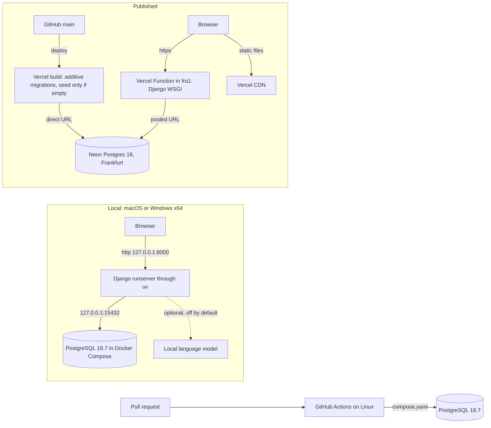
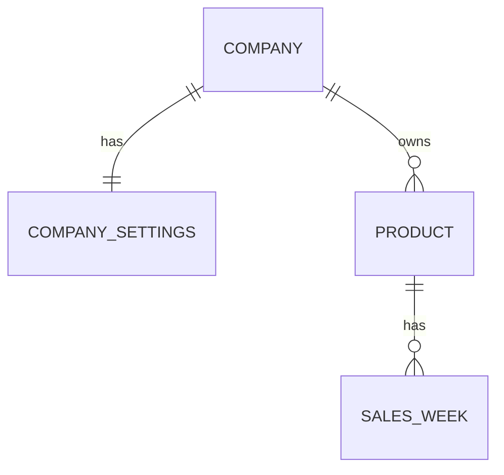

# Architecture Spine — Prognose

## Design Paradigm

A **server-rendered Django monolith with a functional core and an imperative shell**. The core is pure Python: inputs in, results out. The shell is one Django app that authenticates, reads and writes PostgreSQL, calls the core and renders HTML.

| Layer | Package (in `src/`) | Holds |
|---|---|---|
| Core | `forecasting/` | rules R-1 to R-17, `ProductResult`, the overview, the FR-20 settings constants, R-9 rounding and the Norwegian number format |
| Core | `explanation/` | every result-dependent Norwegian sentence, the template explanation, the FR-27 and FR-28 checks |
| Shell | `web/` | the company user, models, company-scoped queries, adjustments, views, forms, chart geometry, templates, static files, management commands, the local-model adapter |
| Project | `prognose/` | settings, URLs and the WSGI entry point |



Arrows point from the depender to the dependency. Nothing points back into the shell.

## Invariants & Rules

### AD-1 — Functional core, imperative shell [ADOPTED]

- **Binds:** all; NFR-2, AG-1
- **Prevents:** calculation rules leaking into views, models, templates or JavaScript, where they cannot be unit-tested against the reference examples
- **Rule:** `forecasting/` and `explanation/` import only the Python standard library, and `explanation/` may import `forecasting/`, never the reverse. They never import Django, a database driver or an HTTP library, and never read the clock, files or environment variables. Every other package may import them.

### AD-2 — One compute path per company

- **Binds:** FR-5 to FR-19, FR-17b, FR-21, FR-24, FR-25, FR-29, FR-30, FR-33 to FR-36; R-1 to R-17; NFR-8
- **Prevents:** two screens showing different numbers, groups or orders for the same data, and stale stored results after a settings change
- **Rule:**
  - The core computes from inputs only: `forecast_product(weeks, stock_on_hand, settings)` returns a frozen `ProductResult`; `build_overview(results, adjustments)` applies R-12 and gives the groups, the week figures, the previous and next product and the combined order overview; `describe_settings_change(before, after)` gives the FR-21 confirmation lines.
  - The shell has one loader, `web/company_data.py`, that reads a company's settings, products, sales weeks and adjustments through `web/queries.py` (AD-7), in a fixed number of queries independent of the number of products, and calls the core. Every page uses it, and the product screen computes the whole overview for its list and its previous and next links.
  - The FR-21 confirmation compares the product the user came from, before and after the change. From a page without a product, it shows only the line naming the new setting.
  - Search hides products from the computed overview. It never changes their order, their results or the week figures.
  - The database stores inputs only. Results are computed on every request and never stored.
  - Nothing outside the core calculates, rounds, sorts or groups domain values.

### AD-3 — One rounding and one Norwegian number format

- **Binds:** R-8, R-9, FR-12, FR-27, FR-35, NFR-5
- **Prevents:** 70 on one screen and 71 on another, «14.3» next to «14,3», and display rounding that disagrees with the reference spreadsheet
- **Rule:**
  - The core keeps full float precision and returns numbers, never formatted strings.
  - Every rounding goes through `forecasting/rounding.py`: first to 6 decimals, then up to whole units (R-8) or half away from zero for display (R-9), with the `decimal` module and never with `round()`.
  - Norwegian display text comes only from `forecasting/display.py`: a decimal comma, the minus sign U+2212, no thousands grouping, and a no-break space before «%». Week labels come from the same module, with the year at New Year and in lists that reach before the recent period. One template-filter module, the explanation and the chart all call it.

### AD-4 — Result wording in one place

- **Binds:** FR-7 to FR-19, FR-17b, FR-21, FR-24 to FR-27, FR-35, FR-36; the EXPERIENCE.md Message Catalogue
- **Prevents:** the list, the trust panel, the chart text and the explanation phrasing the same warning differently
- **Rule:** every Norwegian sentence that depends on a result comes from `explanation/`, with the EXPERIENCE.md Message Catalogue as its copy source: warnings, notes, confidence reasons, the forecast and order calculation lines, the FR-21 confirmation, the chart summary and the template explanation. Templates place these strings and never compose them. Fixed interface text lives in the templates.

### AD-5 — Explanation guardrails

- **Binds:** FR-26, FR-27, FR-28, AG-1 to AG-5, SM-6
- **Prevents:** a number in the explanation that the screen does not show, a language model supplying or moving a number, and network calls from anywhere else
- **Rule:**
  - Every explanation template is written with named placeholders in curly braces, such as `base_forecast`. The template path fills them from `ProductResult` through `forecasting/display.py`.
  - `ProductResult` exposes the FR-27 allowed numbers as display strings. A test takes every number from every template explanation and checks it against them.
  - The FR-28 checks are pure functions in `explanation/`: placeholder names, count and order; the §3 label before each placeholder; no number outside a placeholder.
  - The only network call in the application is `web/rephrase.py`. It uses the standard library and a 10-second timeout, and it is off unless the local `.env` names a model URL. It never runs on Vercel, and it returns the template text on any failure.

### AD-6 — The company is the authenticated principal [ADOPTED]

- **Binds:** FR-1, NFR-3
- **Prevents:** two ways of linking data to a company, and pages reachable without login
- **Rule:** the custom user model `web.Company` has `customer_number` as its login field and is created in the first migration. Passwords use Django's default PBKDF2 hasher. `LoginRequiredMiddleware` denies by default; only the login page at the app root and the error pages, which show no company data, are exempt. Logging out is a POST.

### AD-7 — Company isolation in one data-access module

- **Binds:** FR-2, SM-4
- **Prevents:** one view forgetting the company filter and showing another company's data
- **Rule:** every read or write of company data goes through functions in `web/queries.py` that take the logged-in company as their first argument and filter by it. Views, forms and the chart never use model managers for company data; only `load_seed` and the migrations touch the tables directly. A lookup outside the company raises `Http404` and renders the same page as an unknown address. The two-account test covers every route in the URL map (AD-11) and every list.

### AD-8 — Weeks by ISO week and position

- **Binds:** PRD §3 (Week, Latest data week), R-10 to R-17, FR-7, FR-18
- **Prevents:** calendar arithmetic that disagrees with the reference examples, and products whose histories end at different weeks
- **Rule:**
  - A week is an ISO 8601 week, identified by its ISO year and week number. A sales week is identified by its product and its position, from 1 to N. The position orders every calculation and measures every distance.
  - Each product's history is a run of consecutive weeks without gaps that ends at the company's latest data week. `load_seed` refuses seed files that break this. The latest data week is derived from the sales weeks and is never stored separately.
  - Calendar arithmetic is used only to label weeks 1 to 3 of the forecast horizon. No domain code reads today's date.

### AD-9 — Settings defined once

- **Binds:** FR-20 to FR-22, NFR-5, NFR-10
- **Prevents:** defaults, ranges and validation drifting between the model, the form, the seed and the core, and a factor on screen that differs from the one used
- **Rule:**
  - Each company has one `CompanySettings` row. The FR-20 defaults and ranges are defined once, in `forecasting/settings.py`; the model defaults, the form validation and `load_seed` read them.
  - The window and both percentages are whole numbers. The smoothing factor has one decimal, from 0,1 to 0,9.
  - Number fields accept a decimal comma or a decimal point. Other input is refused with a Norwegian message, and the previous value stays.

### AD-10 — Server-side state and Post/Redirect/Get

- **Binds:** FR-20 to FR-22, FR-29 to FR-31, NFR-10, NFR-11, DR-4
- **Prevents:** client-side state that diverges from the server, double submissions, and two storages for adjusted quantities
- **Rule:**
  - Every change is an HTML form POST with CSRF protection, followed by a redirect: login, logout, settings, the unusual-weeks switch and adjusted quantities. Navigation and search are GET requests. There are no fetch or XHR calls and no client-side state.
  - Adjusted order quantities live in the server-side session, which uses Django's database backend. They are keyed by product number and latest data week and reached only through `web/adjustments.py`, and they enter the core as an input. FR-31 replaces only the storage behind that module.
  - Only the explicit reset in AD-15 deletes sessions.

### AD-11 — Rendering, URLs and the chart

- **Binds:** FR-24, FR-25, FR-35, NFR-1, NFR-6, NFR-7, NFR-11; DESIGN.md; EXPERIENCE.md
- **Prevents:** a CDN or front-end library dependency, chart code that computes values, and drift from the approved design
- **Rule:**
  - Pages are Django templates. One stylesheet defines the DESIGN.md tokens as CSS custom properties, and components use only those variables. Fonts are the system stacks in DESIGN.md. There is no front-end framework, UI library, web font or CDN.
  - The forecast chart is inline SVG rendered on the server, as in the approved mockup. A pure function in `web/chart.py` computes its geometry from `ProductResult` and display strings only, and its summary text comes from AD-4.
  - One optional script, `web/static/web/app.js`, only enhances: arrow keys, scroll positions, submitting the switch and filtering while typing. Every function works without it.
  - URL map, with Norwegian slugs:

    | Path | Page or action |
    |---|---|
    | `/` | Innlogging (GET and POST) |
    | `/logg-ut/` | log out (POST) |
    | `/produkter/` | Produktoversikt, with `?sok=` for search |
    | `/produkter/<varenummer>/` | Produktside |
    | `/produkter/<varenummer>/mengde/` | set or reset an adjusted quantity (POST, FR-29) |
    | `/innstillinger/` | Innstillinger (GET and POST); returns to the page it came from, which must be a path inside the app |
    | `/innstillinger/uvanlige-uker/` | the unusual-weeks switch (POST) |
    | `/bestillingsoversikt/` | Samlet bestillingsoversikt (FR-30) |

  - DESIGN.md and EXPERIENCE.md win over the mockup.

### AD-12 — Norwegian error pages

- **Binds:** NFR-10, FR-2; the EXPERIENCE.md Message Catalogue
- **Prevents:** a stack trace, a debug page or an English default page reaching a user
- **Rule:** DEBUG is off unless the local `.env` turns it on. The responses 400, 403 (including a failed CSRF check), 404 and 500 render Norwegian pages with the Message Catalogue texts in the not-found panel. A database connection error renders the Database unavailable page with status 503. Errors are logged to the console without request bodies, passwords, secrets or database URLs.

### AD-13 — Run modes and configuration

- **Binds:** NFR-1, NFR-3, NFR-9, NFR-10, SM-2, DR-10, SM-9
- **Prevents:** a published version that differs from the local one in unlisted ways, secrets in the repository, and a setup that needs file editing
- **Rule:**
  - Settings read only environment variables. Locally they first load an optional `.env`; on Vercel `.env` is never read. Nothing in `.env` is needed for the basic setup.
  - **Local mode** (no `VERCEL` variable): `DATABASE_URL` defaults to the Docker Compose database, `postgresql://prognose@127.0.0.1:15432/prognose`. The session secret comes from the git-ignored file `.secret_key`, which `load_seed` creates when it is missing and never overwrites. The app runs with `uv run python src/manage.py runserver --insecure` on 127.0.0.1.
  - **Published mode** (`VERCEL` set): DEBUG is forced off. `ALLOWED_HOSTS` and the https `CSRF_TRUSTED_ORIGINS` come from `VERCEL_PROJECT_PRODUCTION_URL` and `VERCEL_URL`. Secure cookies and `SECURE_PROXY_SSL_HEADER` are on. Startup stops with a clear error when `SECRET_KEY` or `DATABASE_URL` is missing. `load_seed` never writes a secret file, and the local language model is never used.
  - `LANGUAGE_CODE` is `nb` and `TIME_ZONE` is `Europe/Oslo` in both modes.

### AD-14 — PostgreSQL in both run modes [ADOPTED]

- **Binds:** FR-4, NFR-1, NFR-9, DR-2, DR-10, SM-5
- **Prevents:** behavior that differs between the local and the published database, migrations through a transaction pooler, and connection settings that break on Neon
- **Rule:**
  - PostgreSQL 18 everywhere: the image `postgres:18.7` in `compose.yaml` locally and in CI, and a Neon Free project with Postgres 18 in AWS Frankfurt when published. Data access goes through the Django ORM and migrations with psycopg 3, without raw SQL.
  - `compose.yaml` holds only the database: user and database `prognose`, trust authentication, the port `127.0.0.1:15432`, a named volume at `/var/lib/postgresql`, `restart: unless-stopped` and a `pg_isready` health check. It is started with `docker compose up -d --wait`.
  - Web requests use the pooled `DATABASE_URL` with `CONN_MAX_AGE = 0` and `DISABLE_SERVER_SIDE_CURSORS = True`. Every `manage.py` command uses `DATABASE_URL_UNPOOLED` when it is set. Published connections require TLS (`sslmode=require`).
  - The tests run against the local PostgreSQL. The app writes no files at request time.

### AD-15 — Seed data and the explicit reset

- **Binds:** FR-1, FR-3, FR-4, DR-3, DR-4, NFR-3, NFR-4
- **Prevents:** plain-text passwords in the repository, seed data that disagrees with the answer key, and user data deleted by a routine command
- **Rule:**
  - `data/generate_seed.py` writes the versioned JSON files in `data/seed/` and gives identical output on every run. The files hold inputs and password hashes made with Django's hasher and a fixed salt per company. The rule test products take their series from the reference spreadsheet (AD-17). The two test companies have disjoint product numbers.
  - `load_seed` without options loads into an empty database only. When any company exists, it stops with a Norwegian message and changes nothing.
  - `load_seed --reset` is the only command that deletes data. It asks for typed confirmation. Then, in one transaction, it deletes the companies with their data and all sessions and loads the seed, so settings and adjustments return to the seed state (DR-4). Nothing runs it automatically.

### AD-16 — Publishing on Vercel without data loss

- **Binds:** DR-10, SM-9, NFR-3, DR-7
- **Prevents:** preview deployments touching the published database, unmerged code reaching it, and a deploy that deletes or overwrites existing data
- **Rule:**
  - One group member owns the Vercel Hobby project, connected to the public GitHub repository, with its functions in region `fra1`. Only `main` deploys: `vercel.json` sets `"git": {"deploymentEnabled": {"**": false, "main": true}}`. The Neon variables exist only for Production. On Vercel the group sets only `SECRET_KEY`.
  - The build script in `pyproject.toml` (`[tool.vercel.scripts] build`) runs the migration step and then `load_seed`, both over the direct URL. The migration step applies the pending migrations only when the database has none applied yet, or when every pending operation is `CreateModel`, `AddField`, `AddIndex`, `AddConstraint` or `AlterModelOptions`. Any other operation stops the build before anything is applied, and the owner decides by hand.
  - A deploy never runs `load_seed --reset`, `flush` or a data migration.

### AD-17 — One test command and one answer key

- **Binds:** NFR-2, DR-3, DR-7, SM-1, SM-3, SM-4, SM-6, SM-7
- **Prevents:** tests and the reference spreadsheet drifting apart, and checks that only some machines run
- **Rule:**
  - `uv run pytest` runs every test against the local PostgreSQL. It covers the core rules, a snapshot of each explanation template, the FR-27 number test, web tests through Django's test client, including the SM-3 core flow and the SM-4 two-account test, an import test for AD-1, and `makemigrations --check`.
  - The reference spreadsheet in `reference/` is the single answer key. The tests and the seed generator read its inputs and expected values with openpyxl, and no expected value is copied into test code.
  - When a test and the spreadsheet disagree, the case is calculated again by hand. Whichever was wrong is corrected, and the finding is recorded in the QA log (DR-9).
  - Every test names the FR-n or E-n it verifies (DR-5).
  - `uv run ruff check` and `uv run ruff format --check` lint and format Python files only.
  - GitHub Actions runs the tests and Ruff on every pull request on Linux, with the database started from the same `compose.yaml`. A pull request is merged only when they pass.

## Consistency Conventions

| Concern | Convention |
| --- | --- |
| Naming | Code is in English with the PRD §3 terms (`base_forecast`, `week_forecasts`, `calculation_weeks`, `safety_margin`, `stock_on_hand`, `weeks_of_cover`, `order_soon`, `confidence_label`). UI text is Norwegian, with the glossary labels and fixed strings verbatim. URL slugs are Norwegian (AD-11). |
| Data and formats | The product number (`varenummer`) is a string of 5 digits, unique within a company. Units sold, stock on hand and quantities are integers; forecasts are floats. Percentages are stored as whole numbers (10 means 10 %); the smoothing factor is stored with one decimal. Enum values: `moving_average`, `exponential_smoothing`, `included`, `excluded`. |
| Errors | Norwegian messages name the problem and the fix. Validation keeps the previous value. Unknown addresses and other companies' objects give the same not-found page (AD-7, AD-12). |
| Logging | Console only. Never log passwords, the session secret, database URLs or request bodies (NFR-4). |
| Configuration | Environment variables only (AD-13). `.env.example` lists every optional local variable and marks each as optional or secret: `PROGNOSE_DEBUG`, `PROGNOSE_LLM_URL`, `PROGNOSE_LLM_MODEL` and `DATABASE_URL`. A production database URL never enters a file, a commit or the shell history. |
| Dependencies | `pyproject.toml` declares the direct dependencies with exact pins; `uv.lock` pins every package exactly and is the one lock file (DR-2); installs use `uv sync --locked`. A new package needs an update to the Stack table. |
| Commands | The README commands are the same on macOS and Windows and run through `uv run`, so no virtual environment is activated: `docker compose up -d --wait`, `uv sync`, `uv run python src/manage.py migrate`, `uv run python src/manage.py load_seed`, `uv run python src/manage.py runserver --insecure`, and `uv run pytest`. |
| Platforms | macOS on Apple silicon or Intel, and Windows 10 22H2 or Windows 11 23H2 on x64, each with Docker Desktop. Windows on ARM is not supported in v1, because psycopg has no wheel for it. |
| Optional features | Should and Could items exist in code only once they are built. There are no runtime feature flags except the FR-28 switch. A story that builds an item updates every place EXPERIENCE.md ties to it, for example the header link, step 3 of the week path and the last-product button for FR-30. |
| Checks before a pull request | Each story is built on its own branch and merged through a reviewed pull request (DR-7). Before that, `uv run pytest`, `uv run ruff check` and `uv run ruff format --check` pass locally and in CI (AD-17). |
| Documents | `docs/` holds `PRODUCT.md`, the `DESIGN.md` link, `arbeidslogg.md`, `qa-logg.md` (DR-9), `ki-styringslogg.md` (DR-5) and `statustabell.md` (DR-8). Session logs and saved AI sessions are in `.logs/`, and story specifications in `_bmad-output/implementation-artifacts/`. |
| Delivery order | The first story proves the whole path: the project skeleton with `compose.yaml` and CI, and the first deploy to Vercel with Neon. Then the Must items. Should and Could items start only after the Must scope passes SM-1 and SM-3 (DR-6). |

## Stack

| Name | Version |
| --- | --- |
| Python | 3.13 (from `.python-version`; uv installs it) |
| Django | 5.2.19 (LTS, supported to April 2028) |
| psycopg[binary] | 3.3.9 |
| PostgreSQL | 18.7 (image `postgres:18.7`); Postgres 18 on Neon |
| Docker Desktop (local prerequisite) | 4.99.0 tested, with Docker Compose v5.7.0 |
| uv | 0.13.9 at authoring (0.12.13 tested) |
| pytest | 9.2.0 |
| pytest-django | 4.14.0 |
| Ruff | 0.17.5 |
| openpyxl (development only) | 3.1.5 |
| Vercel | Hobby plan, Python runtime, region `fra1` |
| Neon | Free plan, AWS Frankfurt, Postgres 18 |

## Structural Seed

```text
G40-lyamouri/
  README.md, pyproject.toml, uv.lock, .python-version, compose.yaml, vercel.json, .env.example, .gitignore
  .github/workflows/   # CI: tests and Ruff on Linux with compose.yaml
  src/
    manage.py
    prognose/          # Django project: settings, urls, wsgi
    forecasting/       # pure: rules R-1 to R-17, ProductResult, overview, settings constants, rounding, display
    explanation/       # pure: result wording, template explanation, FR-27 and FR-28 checks
    web/               # Django app: Company, models, queries, company_data, adjustments, views, forms,
                       #   chart, rephrase, middleware, templates, static, management commands
  tests/               # pytest
  data/                # generate_seed.py and seed/ (versioned JSON)
  reference/           # the reference spreadsheet, the answer key (DR-3)
  docs/                # PRODUCT.md, DESIGN.md link, arbeidslogg, qa-logg, ki-styringslogg, statustabell
  _bmad/ _bmad-output/ .claude/ .impeccable/ .logs/   # BMAD, planning artifacts, Claude Code, Impeccable, session logs
```





## Capability → Architecture Map

| Capability / Area | Lives in | Governed by |
| --- | --- | --- |
| Login and isolation (FR-1, FR-2) | `web` (Company, `queries.py`) | AD-6, AD-7 |
| Seed data and storage (FR-3, FR-4) | `data/`, `web` models, `load_seed`, `compose.yaml`, Neon | AD-8, AD-14, AD-15 |
| Forecasts, scenarios and order quantities (FR-5 to FR-14) | `forecasting/` | AD-2, AD-3, AD-8, AD-9 |
| Warnings and confidence (FR-15 to FR-19, FR-17b, FR-36) | `forecasting/`, wording in `explanation/` | AD-2, AD-4 |
| Settings (FR-20 to FR-23) | `forecasting/settings.py`, `web` (CompanySettings, forms, views) | AD-9, AD-10 |
| Overview, product screen and forecast calculation (FR-24, FR-25, FR-35) | `web` views and templates, `web/chart.py` | AD-2, AD-4, AD-11 |
| Explanation (FR-26 to FR-28) | `explanation/`, `web/rephrase.py` | AD-4, AD-5 |
| Purchase planning (FR-29 to FR-32) | `web/adjustments.py`, the overview in `forecasting/`, views | AD-2, AD-10 |
| Stock note and accuracy (FR-33, FR-34) | `forecasting/` | AD-2 |
| Robustness and error pages (NFR-10) | `web` middleware and templates | AD-10, AD-12 |
| Run modes and publishing (NFR-1, NFR-3, NFR-9, DR-10, SM-2, SM-9) | `src/prognose/settings.py`, `compose.yaml`, `vercel.json`, `pyproject.toml`, Vercel, Neon | AD-13, AD-14, AD-16 |
| Tests and quality (NFR-2, DR-3, DR-7, SM-1, SM-3, SM-4, SM-6, SM-7) | `tests/`, `reference/`, `.github/workflows/` | AD-17 |
| Delivery and process documents (DR-1, DR-2, DR-5, DR-6, DR-8, DR-9) | README, `docs/`, `.logs/` | Consistency Conventions |

## Deferred

- **Local language model (FR-28, PRD §10 question 5):** the runtime and the model are chosen when FR-28 is scheduled, as the last Should item. AD-5 fixes the seam; how the 10-second timeout fits NFR-8's 2 seconds is decided then.
- **Schemas of the seed JSON and of the spreadsheet's answer-key sheet:** set in the data story. AD-15 and AD-17 fix who writes and who reads them.
- **Could items:** FR-31 replaces only the storage behind `web/adjustments.py` (AD-10); FR-23 needs an amendment to AD-9; FR-32 to FR-34 are decided when scheduled.
- **Caching:** only if the NFR-8 check fails, and it needs an amendment to AD-2.
- **Not in v1:** a Content Security Policy, browser end-to-end tests (Playwright) and rate limiting, because the test logins are public in the README.
- **Operations:** no monitoring, backup or alerting service in v1. The demo holds synthetic data only, an explicit reset restores it (DR-4), and the Vercel and Neon dashboards show the logs.
- **Validation messages the Message Catalogue lacks,** for a percentage with decimals or a factor with two decimals: settled in the settings story under the UX copy rules.
- **Tests not run yet** (recorded in `docs/qa-logg.md`): the offline start with Docker Desktop, and the whole README setup on Windows x64. Both run in the first story and again on the final commit (DR-9, SM-2).
- **Checks in the first story:** the IBE160-2026 organization must allow the Vercel GitHub app; otherwise the owner deploys `main` with the Vercel CLI. Also check Vercel Hobby's commit-author rule, that Vercel detects `manage.py` in `src/` and runs the build script with `DATABASE_URL_UNPOOLED`, that Neon offers Postgres 18 in AWS Frankfurt when the project is created, and that GitHub Actions is allowed in the organization.
- **Free-plan terms:** re-checked before submission: Vercel Hobby is for non-commercial use, Neon Free has usage limits, and Docker Desktop is free for personal use and education.
